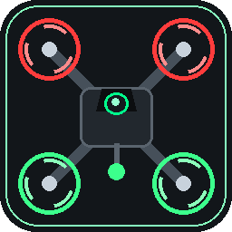

<p align="center"></p>

# FPV Drones

**Настоящие FPV-квадрокоптеры и самолёты в Minecraft.** Соберите дрон из деталей, привяжите пульт, наденьте очки и летайте в полном акро: с реальной RC-аппаратурой или на мыши и клавиатуре. Гоняйте через ворота, выполняйте ударные вылеты, защищайте базу глушилками или поставьте дрону прошивку компаньона, чтобы он летал за вами.

> Minecraft **26.1 – 26.1.2** · NeoForge **26.1+** · Java 25 · ставится **и на клиент, и на сервер**

[English version](README.md)

---

## Возможности

### Полёт
- **Физическая модель.** 1 блок = 1 метр. Учитываются тяга, масса, анизотропное сопротивление воздуха, просадка напряжения батареи и перекос моторов и пропов, из-за которого дрон уводит в сторону.
- **Режимы полёта:** Acro, Angle, Horizon и Alt Hold, плюс Turtle — перевернуть упавший дрон. Переключаются в полёте; rates и expo настраиваются по каждой оси.
- **Настоящие RC-пульты** по USB (RadioMaster, Jumper и др.). Оси и инверсия настраиваются прямо в игре с живым отображением стиков.
- **Мышь и клавиатура** тоже работают. При подключённом пульте клавиатура остаётся подстройкой газа.
- **Клиентское предсказание.** Дрон, которым вы управляете, откликается мгновенно даже на лагающем сервере.
- **Настраиваемый наклон FPV-камеры** и полноценное OSD: телеметрия, газ, стики, горизонт, шкала тангажа, курс, схема повреждений и сетевая статистика. Каждый элемент отключается.
- **Реплеи.** Сохраняйте последние 30 секунд полёта, перематывайте и смотрите с разной скоростью. После крушения реплей сохраняется сам.

### Техника
- **Мультикоптеры:** Tiny Whoop, Cinewhoop, 5" гоночный, 7" дальнолёт, тяжёлые 6" гекса и 8" окто, торпедообразный перехватчик.
- **Самолёты:** тренер, летающее крыло, дельта-гонщик, планер, грузовой, крыло-разведчик, крыло-камикадзе, барражирующий ударный дрон и дрон-носитель.
- **Станция сборки.** Вставьте раму, моторы, пропеллеры, батарею, камеру, VTX, полётный контроллер, прошивку и модули. Станция сразу показывает массу, тягу, TWR и газ висения, а изношенные детали чинит ванильными материалами.
- **Износ и повреждения** у каждой детали, со схемой повреждений на HUD.
- **Ёмкость батарей** как у реальных сборок: от 1S 300 мАч до 6S 5000 мАч. Время полёта зависит от стиля пилотирования. Заряжаются на **зарядной станции**.
- **Карточки дронов.** Собранный аппарат складывается в карточку, её можно загрузить в отсек носителя и снова развернуть на станции.

### Связь и управление
- **Пульт.** Shift + ПКМ по аппарату привязывает пульт, ПКМ запускает полёт. Пульт увеличенной дальности держит связь на большем расстоянии.
- **FPV-очки** дают видеосигнал. Без них вы летаете визуально и смотрите на дрон своими глазами.
- **Модель радиосвязи:** дальность, потеря сигнала без прямой видимости, мощность VTX, failsafe.
- **Станция управления:** управление привязанным аппаратом с земли на большой дистанции, тело остаётся у станции.

### Боевое
- **Модули:** ракетный блок (6 мини-ракет), грузовой отсек (сбросные заряды), боевая часть, дротиковое орудие, прицельный контейнер, грузовой ящик.
- **Боевые части:** фугасная, осколочная, кумулятивная, термобарическая, кассетная, неконтактная, тяжёлая и сбросной заряд. У каждой свой радиус взрыва, воронка и урон по мобам.
- **Пусковая станция камикадзе** запускает барражирующие боеприпасы по отмеченной точке.
- **Крыло-разведчик:** кружит над точкой и вызывает ударное крыло по цели.
- **Противодронная защита:**
  - **Детектор дронов** выдаёт редстоун-сигнал, когда рядом дрон.
  - **Глушилка** рвёт связь дронов в радиусе. Она работает только от редстоуна, поэтому ставьте рядом детектор.

### Мир и ИИ
- **Враждебные дроны:** мини-камикадзе, ракетные, бомбардировщики, глушилки, патрульные и перехватчики.
- **Гнёзда дронов** генерируются в мире и запускают дроны по игрокам поблизости.
- **Деревни** получают собственные дроны-охранники.
- **Прошивки** превращают ваш дрон в ИИ-помощника. Режим переключается через Shift + ПКМ.
  - *Компаньон* следует за владельцем.
  - *Страж* атакует враждебных мобов и защищает вас.
  - *Разведчик* подсвечивает врагов сквозь стены и умеет патрулировать.
  - *Торговец* превращает дрон в летающего торговца.
- **Сторожевая станция:** пристыкованные дроны вылетают в патруль и возвращаются на подзарядку.

### Гонки
- **Блоки старта, ворот и финиша.** Маршрут размечается кликами по воротам по порядку. Трасса бывает кольцевой или от точки до точки.
- **Таймер кругов на HUD и таблица рекордов.**
- **Призраки** личного рекорда и рекорда трассы летят рядом с вами.
- **Природные гоночные трассы** могут генерироваться в мире, настройки в `fpv-track-generation.toml`.

---

## Быстрый старт

1. Скрафтите **станцию сборки** и детали: раму, 4 мотора, 4 пропеллера, батарею и камеру. Основа рецептов — медь и редстоун.
2. Соберите дрон и поставьте его на землю.
3. Скрафтите **пульт**, наведитесь на дрон и нажмите **Shift + ПКМ**, чтобы привязать.
4. Наденьте **FPV-очки** и нажмите **ПКМ** с пультом в руке.
5. **Z** — арм, добавьте газ. **Shift** — выход.

---

## Управление

Все клавиши переназначаются в **настройках FPV** (**O** или маленькая кнопка с дроном в главном меню и меню паузы).

| Клавиша | Действие |
|---|---|
| **O** | Настройки FPV |
| **Z** | Арм / дизарм |
| **R** | Смена режима полёта |
| **C** | Мышь: полёт / обзор |
| **H** | Скрыть / показать HUD |
| **Page Up / Page Down** | Наклон камеры |
| **F** | Огонь (ракеты, дротики) |
| **X** | Сброс заряда |
| **Q / E** | Рыскание у тяжёлых дронов |
| **V** | Вернуть подвес камеры в центр |
| **G** | Самолёт: кружить над точкой под прицелом |
| **B** | Крыло-разведчик: вызвать удар |
| **F6** | Сохранить последние 30 секунд |
| **F7 / F8 / F9** | Реплей: запуск или выход / пауза / скорость |
| **[ / ]** | Реплей: назад / вперёд на 5 секунд |
| **Shift** | Выйти из управления |

**Квадрокоптеры на клавиатуре:**
- **W / S** — газ.
- **A / D** — рыскание.
- **Мышь** — тангаж и крен.

Тяжёлые дроны управляются иначе:
- **WASD** — движение.
- **Пробел / Бег** — подъём и спуск.
- **Q / E** — рыскание.

**Самолёты:**
- **W / S** или **Пробел / Бег** — газ.
- **Мышь** — тангаж и крен.
- **A / D** — руль направления.

---

## Экран настроек FPV

Открывается клавишей **O** в игре или маленькой кнопкой с дроном в главном меню и меню паузы.

- **Управление:** rates, expo, чувствительность мыши, оси и инверсия RC-пульта, мёртвая зона, середина газа.
- **Клавиши:** все клавиши мода в одном месте, конфликты подсвечиваются.
- **Интерфейс:** включение и выключение каждого элемента HUD.
- **Creative:** правила сервера. Вкладка видна в творческом режиме тем, кому разрешено их менять (одиночная игра или оператор).

---

## Правила сервера и команды

Игровые правила хранятся в конфиге сервера, действуют на всех и автоматически синхронизируются с клиентами.

Операторы (уровень прав 2) меняют их:
- во вкладке **Creative** экрана настроек;
- командами.

| Команда | Что делает |
|---|---|
| `/fpv rules` | Список всех правил (клик по правилу подставит команду) |
| `/fpv rules <правило>` | Текущее значение, значение по умолчанию и диапазон |
| `/fpv rules <правило> <значение>` | Изменить правило |
| `/fpv rules <правило> reset` | Сбросить одно правило |
| `/fpv rules reset` | Сбросить все правила |

| Правило | Тип | По умолчанию | Описание |
|---|---|---|---|
| `battery` | true/false | `true` | Батареи разряжаются и проседают. Выкл. = бесконечный полёт |
| `infiniteAmmo` | true/false | `false` | Ракеты и заряды не расходуются |
| `noDamage` | true/false | `false` | Дроны и детали не изнашиваются и не ломаются |
| `radio` | true/false | `true` | Дальность связи, потеря сигнала без прямой видимости, глушение |
| `requireTransmitter` | true/false | `true` | Для полёта нужен пульт в руке |
| `requireGoggles` | true/false | `true` | Для FPV нужны очки, без них полёт только визуальный |
| `explosionPower` | 0.4 – 40 | `4` | Общая мощность боевых частей (4 = 1x) |
| `blockBreak` | 0 – 100 | `100` | Процент блоков, которые реально разрушает взрыв |
| `debris` | 0 – 200 | `100` | Процент блоков, разлетающихся обломками |
| `mobDamage` | 0 – 5 | `1` | Множитель урона от взрыва по мобам |
| `blastCameraSeconds` | 0 – 6 | `5` | Сколько секунд камера смотрит на взрыв после удара камикадзе |
| `motorPower` | 0.2 – 5 | `1` | Общий множитель мощности моторов |
| `maxSpeed` | 10 – 150 | `60` | Потолок скорости квадрокоптеров, м/с. Только ограничивает: реальная скорость зависит от тяги и сопротивления, поэтому чтобы летать быстрее, поднимай `motorPower`. У самолётов свой предел от рамы |

Примеры:

```
/fpv rules battery false
/fpv rules explosionPower 8
/fpv rules blockBreak 0
/fpv rules reset
```

### Взрывчатка

Помимо общих правил, у каждой взрывчатки есть свои параметры. Они хранятся в `config/fpv-explosives.toml`, а часть из них вынесена во вкладку **Creative**, раздел *Боеприпасы*.

| Команда | Что делает |
|---|---|
| `/fpv explosives` | Список всей взрывчатки с текущими значениями |
| `/fpv explosives <id>` | Параметры одной взрывчатки |
| `/fpv explosives <id> <параметр> <значение>` | Изменить параметр |
| `/fpv explosives <id> <параметр> reset` | Сбросить один параметр |
| `/fpv explosives <id> reset` | Сбросить все параметры одной взрывчатки |
| `/fpv explosives reset` | Сбросить всю взрывчатку |

| Id | Параметры по умолчанию |
|---|---|
| `mini_rocket` | `power` 1.4, `impactDamage` 5, `blocks` 1, `hardness` 6 |
| `hostile_drone` | `power` 1.8, `breakBlocks` true |
| `drop_charge` | `power` 2, `blockPower` 0.9, `mobDamage` 1.5, `submunitions` 0, `fire` false |
| `warhead_frag` | `power` 3, `blockPower` 1.3, `mobDamage` 2.4, `submunitions` 0, `fire` false |
| `warhead_shaped` | `power` 3.4, `blockPower` 2.2, `mobDamage` 1.8, `submunitions` 0, `fire` false |
| `warhead_he` | `power` 4.4, `blockPower` 4, `mobDamage` 1.3, `submunitions` 0, `fire` false |
| `warhead_cluster` | `power` 2.6, `blockPower` 1.5, `mobDamage` 1.5, `submunitions` 5, `fire` false |
| `warhead_thermo` | `power` 6, `blockPower` 3.2, `mobDamage` 3, `submunitions` 0, `fire` true |
| `warhead_heavy` | `power` 8, `blockPower` 6.6, `mobDamage` 1.6, `submunitions` 0, `fire` false |
| `warhead_proximity` | `power` 3.2, `blockPower` 0.6, `mobDamage` 2.8, `submunitions` 0, `fire` false |

| Параметр | Диапазон | Смысл |
|---|---|---|
| `power` | 0 – 40 | Мощность взрыва: радиус, эффекты и урон по мобам |
| `blockPower` | 0 – 40 | Сила взрыва по блокам. 4 = воронка от динамита, 0 = блоки не ломает |
| `mobDamage` | 0 – 20 | Множитель урона по мобам |
| `submunitions` | 0 – 16 | Дополнительные суббоеприпасы вокруг точки взрыва |
| `fire` | true/false | Поджигает всё вокруг точки взрыва |
| `impactDamage` | 0 – 100 | Урон сущности при прямом попадании |
| `blocks` | 0 – 16 | Сколько блоков ракета пробивает по траектории |
| `hardness` | 0 – 100 | Самый твёрдый блок, который ракета может сломать (камень 1.5, обсидиан 50) |
| `breakBlocks` | true/false | Взрыв ломает блоки (с учётом `mobGriefing`) |

Значения боевых частей дополнительно масштабируются общими правилами `explosionPower`, `blockBreak`, `debris` и `mobDamage`.

```
/fpv explosives mini_rocket blocks 4
/fpv explosives mini_rocket impactDamage 12
/fpv explosives warhead_he blockPower 0
/fpv explosives hostile_drone breakBlocks false
```

---

## Файлы конфигурации

| Файл | Сторона | Что внутри |
|---|---|---|
| `config/fpv-client.toml` | клиент | Управление, оси пульта, мышь, HUD |
| `config/fpv-common.toml` | сервер | Правила выше, радио, глушилки, дальность пультов, производительность |
| `config/fpv-explosives.toml` | сервер | Параметры каждой взрывчатки |
| `saves/<мир>/serverconfig/fpv-track-generation.toml` | мир | Генерация природных гоночных трасс |

`clientSidePhysics` в common-конфиге считает физику дрона на клиенте пилота, чтобы управление оставалось плавным на лагающем сервере. Отключите, если нужна строгая серверная авторитетность.

---

## Сборка из исходников

```powershell
.\gradlew.bat build
```

Jar появится в `build/libs/`. Подробнее в [BUILD.md](BUILD.md) и [ARCHITECTURE.md](ARCHITECTURE.md).

## Лицензия

[MIT](LICENSE)
